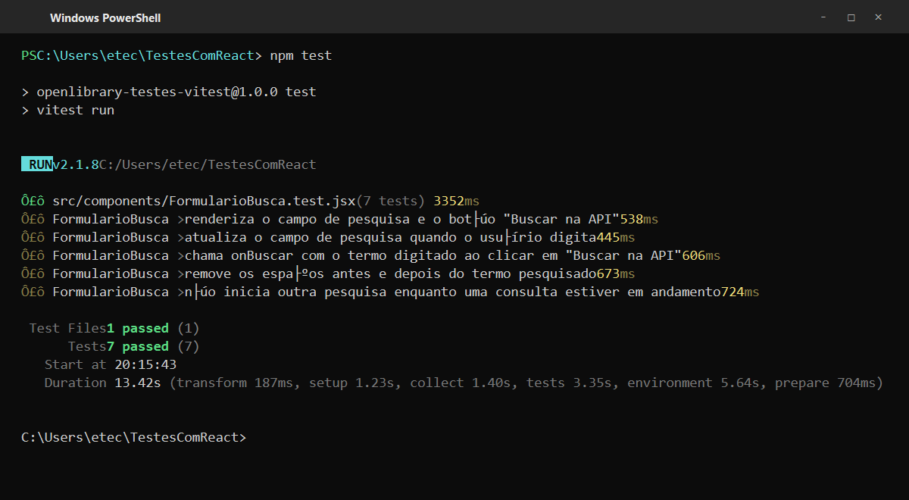

# TestesComReact

Atividade prática de **Testes automatizados com React e Vitest** para a aplicação OpenLibrary.

## Executar o projeto

```bash
npm install
npm run dev
```

A aplicação fica disponível em `http://localhost:5173`.

## Executar os testes

```bash
npm test
```

O arquivo `src/components/FormularioBusca.test.jsx` contém os 4 testes desenvolvidos em aula e os 3 novos testes:

1. não chama `onBuscar` quando a pesquisa contém apenas espaços;
2. remove os espaços antes e depois do termo pesquisado;
3. não permite nova pesquisa enquanto `carregando` é `true`.

Resultado: **7 testes aprovados**.

## Captura do terminal


